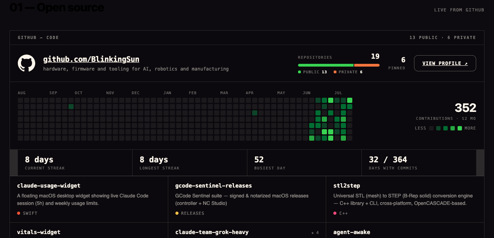

# github-web

**Put your GitHub stats on your own website, and let your coding agent keep them current on
a schedule.** Contribution heatmap, streaks and activity stats, a public/private repository
split bar, and your pinned repo cards with live star and fork counts.



Packaged as an **agent skill** — a `SKILL.md` your agent reads and follows. `/github-web`
walks you through GitHub API access, installs the section into your page, and sets up the
automatic refresh on whatever machine you have. Works with Claude Code, Cursor, the Grok
CLI, or anything else that can read a skill file and run a shell. It is also a plain set of
scripts — see [Without an agent](#without-an-agent).

---

## What makes it different

**The data is rendered into static HTML at build time.** A Node script fetches from the
GitHub GraphQL API and rewrites marked-up regions of your page in place. That means:

- **No client-side JavaScript.** Works on a site with `script-src 'none'`, and with JS
  disabled entirely.
- **No token in the browser.** The credential never leaves the machine that runs the sync.
- **No API call per visitor.** No rate limits, no latency, no third-party request from
  your reader's browser.
- **It is just HTML.** Your page keeps working if this project disappears.

The trade-off is that it needs *something* to run on a schedule. That can be a server you
own, or GitHub Actions for free — the package ships templates for both.

---

## What it renders

| Element | Notes |
|---|---|
| 53×7 contribution heatmap | real daily counts, GitHub's own green ramp |
| 12-month contribution total | includes private contributions if your profile allows it |
| Current / longest streak | counted to the last **completed** UTC day, so it never reads 0 mid-day |
| Busiest day, days with commits | derived |
| Repository split bar | public vs private; both widths derived from the counts, never authored |
| Pinned repo cards | the six pinned on your profile, with language dot + description |
| Star and fork counts | on **both** breakpoints, sized to the repo name beside them; a zero renders nothing at all |
| Achievement badges *(optional)* | your own image, per repo — see [Achievements](#achievements) |
| Recent pushes *(optional)* | last three repos by push time, with relative age. Private ones are shown but not linked — the URL 404s for visitors |

Desktop and mobile variants are both supported (`data-gh-view="desktop"` / `"mobile"`);
a page can carry either or both. The mobile card puts its counters on the *language* row
rather than the name row — repo names run long enough to wrap on a phone-width card and
would shove a right-aligned count around.

---

## Install

### As an agent skill

```bash
git clone https://github.com/BlinkingSun/github-web-skill.git \
  ~/.claude/skills/github-web
```

Then run `/github-web` and answer the questions. It will ask where your site is, how it
publishes, and which machine is always on, then do the rest with you.

Other agents keep their skills elsewhere — Cursor and the Grok CLI can both be pointed at
the same directory. The skill itself is plain Markdown and shell; nothing in it is
Claude-specific.

### Without an agent

```bash
git clone https://github.com/BlinkingSun/github-web-skill.git github-web
cd github-web

# 1. paste assets/section.html into your page, assets/section.css into your stylesheet
#    replace YOUR_GITHUB_USERNAME and YOUR_TAGLINE

# 2. credentials
cp .env.example .env && chmod 600 .env    # then edit it

# 3. run it
./scripts/sync.sh
```

`SKILL.md` reads perfectly well as a manual setup guide — the phases are the same either
way.

---

## Achievements

GitHub's API exposes profile achievements **nowhere** — they are account-level trophies,
not repository fields — and their artwork is not ours to redistribute. So badges are opt-in
and you supply the image.

Create `data/achievements.json`, keyed by repository name:

```json
{
  "my-repo": { "src": "/assets/achievements/starstruck.png", "label": "Starstruck" }
}
```

`src` is used verbatim as the ``, so host the file with your site. The badge is
drawn at 22px on desktop cards and 18px on mobile. No file means no badges, which is the
default.

**The image is not masked** — no `border-radius` is applied, so whatever shape your PNG's
alpha describes is the shape you get. That is deliberate: GitHub's tiered badges are not
discs (the `×2` / `×3` pill overhangs the bottom-right), and a circular mask would slice
that corner off. Crop the file the way you want it drawn.

Bumping a tier? **Use a new filename.** Assets are usually cached hard, so overwriting the
old file serves stale art to returning visitors until it expires.

See [reference/achievements.example.json](reference/achievements.example.json).

---

## Requirements

- **Node 18+** (uses the built-in `fetch`)
- A **GitHub token** — the contribution calendar and pinned items are GraphQL-only and
  require auth even for public data. See [docs/API-SETUP.md](docs/API-SETUP.md).
- Somewhere to run a scheduled job — or GitHub Actions.

If your site sets a `Content-Security-Policy`, the renderer emits inline-styled markup, so
you need `style-src ... 'unsafe-inline'` or a nonce. Nothing else needs changing — in
particular `script-src 'none'` is fine, which is the whole point. The fork glyph is an
inline `<svg>` for the same reason.

---

## Two things that will save you an hour

**1. Your contribution total may be a fifth of what you expect.** GitHub excludes private
contributions from the calendar unless you opt in at
[Settings → Profile → Contributions](https://github.com/settings/profile). In one real
case the total read 69 instead of 350.

The tell is `restrictedContributionsCount: 0` in the fetched data — that field counts
private contributions that *are* included but redacted, so `0` means **excluded entirely**,
not "you have none".

**2. Do not tidy up the heatmap CSS.** Each week column carries its own explicit
`grid-template-columns`. It looks redundant. Remove it and the implicit column resolves to
`0`, all 371 squares render at zero width, and you get a clean empty band — no error, no
warning, and a page that looks deliberately designed that way.

---

## How it behaves when things go wrong

**Fail-closed, deliberately.** A bad token, a network failure or a malformed response
restores the last-good data, leaves your page byte-identical, and skips the publish. A
half-updated section is worse than a stale one, because it looks fine.

**A missing container is fatal.** If the renderer cannot find a `[data-gh]` region it
expects, it exits non-zero and names it. An earlier version skipped quietly and exited 0 —
which shipped a page with the heatmap and all six repo cards missing while the counters
still updated, so it looked alive. That is why the check is loud now.

More in [docs/TROUBLESHOOTING.md](docs/TROUBLESHOOTING.md).

---

## Layout

```
SKILL.md                     the guided setup (also a fine manual)
assets/section.html          the markup — [data-gh] hooks, no data
assets/section.css           self-contained styles + the design tokens they need
scripts/fetch-github.mjs     GraphQL -> data/github-contributions.json
scripts/validate.mjs         schema + sanity checks
scripts/render-github.mjs    data -> your HTML, in place
scripts/sync.sh              fetch -> validate -> render -> (publish)
publish.sh.example           your deploy step; copy and edit
scheduling/                  launchd, systemd, cron, Task Scheduler, GitHub Actions
schema/                      JSON Schema for the data file
reference/                   sample data + an achievements example, so you can render
                             before you have a token
docs/                        API setup, troubleshooting
```

---

## Provenance

Extracted from the GitHub section of [makerinparadise.com](https://makerinparadise.com),
where it has been running against the live API since 2026-08-01. The scripts carry fixes
found in production, including:

- `locate()` re-quoting an already-quoted attribute, which made the heatmap and every repo
  card vanish while still exiting 0
- the streak counting the in-progress UTC day, reporting `0` while a streak was running
- a missing data file producing an `ENOENT` stack trace instead of telling you to run the
  fetch first
- card counters rendered at 10.5px and 40% opacity, which is a number nobody reads — stars
  and forks now match the repo name they sit beside

Companion skill: **[thingiverse-web](https://github.com/BlinkingSun/thingiverse-web-skill)**
— the same idea for your Thingiverse designs, downloads and thumbnails.

---

## Licence

MIT. See [LICENSE](LICENSE).

The fork glyph is [Octicons](https://github.com/primer/octicons) (MIT, © GitHub Inc.),
inlined as a path.
